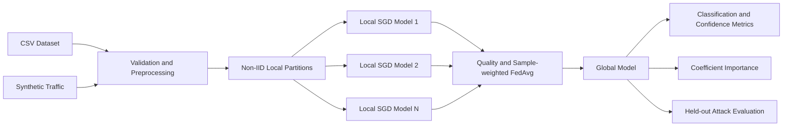

# Adaptive Federated Learning for Zero-Day Intrusion Detection

A complete local research application for simulated adaptive federated intrusion detection. The system combines synthetic traffic generation, per-client SGD training, federated averaging, confidence-based anomaly evaluation, explainability, SQLite persistence, FastAPI, React, and TypeScript.

## Overview

Distributed networks can improve intrusion models without exporting raw flows to a central collector. This project implements that idea in one local process: simulated clients receive disjoint traffic partitions, train local SGD classifiers, and send only coefficients to a federated aggregator. Raw records stay partitioned in memory within the simulation.

The application includes nine operational views: overview, federated learning, traffic analysis, zero-day detection, explainable AI, client management, model performance, reports, and settings.

## Important scope

- Synthetic data is simulated and must not be presented as real network traffic.
- Federated clients are simulated locally and are not independent processes or machines.
- No secure aggregation, differential privacy, Byzantine robustness, or production network isolation is claimed.
- The unseen-attack test measures behavior empirically and does not guarantee discovery of novel attacks.

## Architecture



## Technology

Backend: Python 3.11+, FastAPI, SQLAlchemy, SQLite, NumPy, Pandas, scikit-learn, Joblib. Frontend: React, TypeScript, Vite, Recharts, Lucide, React Router. PDFs are exportable through the backend-generated report layer; the current UI provides reliable CSV export.

## Adaptive strategy

The federated aggregation uses client sample counts multiplied by a local-quality factor of $1/(1+\text{local error})$. A drift score compares recent global loss against expected round progress. Configured sensitivity can exclude unstable local clients from a communication round, and a further round can be configured when the researcher reruns training.

Concept drift detection is based on observed model loss change, not on a claim of universal distributional detection. Users should treat a drift-sensitivity value above zero as an input-controlled participation filter. The model does not persist drift events yet; current experiment records preserve rounds and metrics.

## Zero-day methodology

A class is held out from training and evaluated separately. Known-class prediction confidence is compared with held-out confidence. Anomaly score is $1 - \text{maximum class probability}$. Results include a configurable threshold, confusion matrix, precision, recall, F1, accuracy, ROC-AUC when classes permit, false-positive rate, and false-negative rate.

This approach is genuine but limited: low confidence can also indicate covariate shift, model uncertainty, noisy traffic, or poor calibration.

## Installation on Windows

Use PowerShell 7 or Windows PowerShell.

```powershell
cd "D:\Zero Day-IDS\adaptive-fl-ids"
py -3.11 -m venv .venv
.\.venv\Scripts\Activate.ps1
python -m pip install --upgrade pip
python -m pip install -r backend\requirements.txt
cd frontend
npm.cmd install
cd ..
Copy-Item backend\.env.example backend\.env
```

Node.js 18 is supported by the pinned frontend toolchain. Node.js 20 is recommended for future package updates.

## Start the application

From the project root:

```powershell
.\start_project.bat
```

Or run separate terminals:

```powershell
cd backend
..\.venv\Scripts\Activate.ps1
python -m uvicorn app.main:app --reload
```

```powershell
cd frontend
npm.cmd run dev
```

Backend: http://localhost:8000

Swagger: http://localhost:8000/docs

Frontend: http://localhost:5173

## Complete demo

1. Open the frontend and select **Overview**.
2. Click **Generate demo data**.
3. Open **Federated Learning**, choose client/round settings, and click **Start training**.
4. Open **Traffic Analysis** and click **Analyze traffic**.
5. Open **Zero-Day Detection**, configure a threshold, and evaluate held-out Botnet traffic.
6. Open **Explainable AI** and **Reports** to inspect coefficient importance and experiment persistence.

## Dataset support

Compatible CSV files require one label column named `label`, `Label`, `attack_cat`, or `class`, plus the supported numeric features. Protocol type is optional and may be categorical. CICIDS and UNSW data commonly require column mapping or cleaning into supported names before upload.

## Tests

```powershell
cd backend
python -m pytest -q
```

Frontend production build:

```powershell
cd frontend
npm.cmd run build
```

## API

Open `/docs` for schemas and live testing. Main endpoints include:

- `GET /api/health`
- `GET /api/dashboard`
- `POST /api/demo/generate`
- `POST /api/datasets/upload`
- `GET /api/datasets/info`
- `POST /api/federated/train`
- `GET /api/federated/status`
- `GET /api/federated/clients`
- `POST /api/predict`
- `POST /api/zero-day/evaluate`
- `GET /api/detections/explainability`
- `GET /api/experiments`
- `GET /api/settings`
- `PUT /api/settings`

## Persistence

SQLite stores experiment metadata, training rounds, simulated client state, and settings. The default database is `backend/adaptive_ids.db`. Model artifacts are stored in `backend/model_artifacts`.

## Explainability

The explainability view reports mean absolute standardized SGD coefficient magnitude by feature. It is a model-intrinsic linear approximation and should not be interpreted as causal evidence. A SHAP dependency is intentionally absent rather than supplied in an unreliable configuration.

## Results

No published benchmark percentages are claimed. Run the synthetic workflow locally, record the metrics it produces, and compare configurations experimentally. Screenshots should be added from actual runs under `docs/screenshots/`.

## Upload to GitHub

```powershell
git init
git add .
git commit -m "Initial adaptive federated IDS implementation"
git branch -M main
git remote add origin https://github.com/YOUR-USER/YOUR-REPOSITORY.git
git push -u origin main
```

## Repository guide

- `backend/app/federated/engine.py`: real local SGD training and FedAvg aggregation.
- `backend/app/services/data_service.py`: synthetic dataset and validation.
- `backend/app/services/pipeline.py`: leakage-conscious preprocessing and persistence.
- `backend/app/main.py`: REST API and experiment orchestration.
- `frontend/src/pages/Page.tsx`: all application pages.
- `frontend/src/services/api.ts`: backend integration.
- `docs/methodology.md`: technical and research limitations.

## Limitations and future work

Future work includes real transport between processes, secure aggregation, differential privacy, class-conditional calibration, online drift algorithms such as Page-Hinkley or ADWIN, standardized cross-validation, stronger anomaly models, and formal privacy threat modeling.

## License

MIT. See [LICENSE](LICENSE). Third-party library licenses remain with their respective maintainers and should be checked against organizational redistribution policies.
